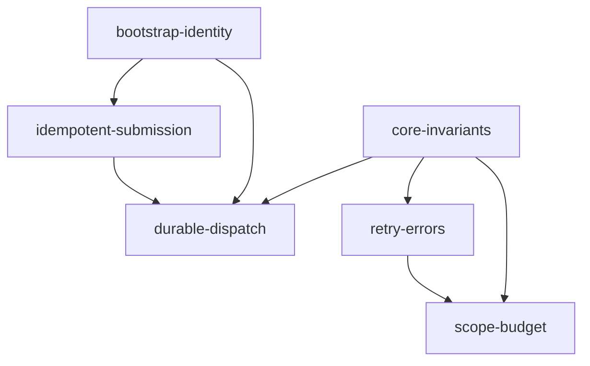

# Training Integration Findings Implementation

## Goal
Resolve all fourteen reviewed findings in the generic apflow service while preserving deterministic orchestration and existing supported library behavior.

## Architecture Design
REST/CLI/MCP/A2A enter the existing registry and per-request session/access boundary. TaskCreator and TaskRepository own transactional creation and immutable/effective reference invariants. TaskExecutor owns actual execution, cancellation, and durable dispatch; TaskManager executes each attempt through existing retry, result, and budget facilities. Network destinations and credentials come from trusted deployment policy. Training/world retain pedagogy, quality criteria, external-effect idempotency and final adoption.

## Reuse Report
- EXTEND TaskRepository update/claim methods, existing Link API resolver, and TaskCreator archive/copy methods; do not create a second repository or snapshot subsystem.
- REUSE TaskExecutor singleton registry, pooled sessions, TaskTracker, existing scheduler and task leasing. EXTEND cancellation and detached dispatch there; do not introduce a second orchestration engine.
- EXTEND existing network_security checks, RestExecutor redirect handling, registry discovery, JWT bridge context and CLI bootstrap. Retain optional plugin tolerance.
- EXTEND RetryManager, canonical result_protocol, BudgetManager and atomic usage accumulation; do not duplicate retry or accounting logic.
- EXISTING_CONFIG: deployment environment/configuration, apcore registry metadata, SQLAlchemy storage/migrations and task scope fields are authoritative.
- EXISTING_TEST_SCAFFOLDING: pytest sync/async SQLite fixtures, MockTransport, function executors and API/CLI clients. Use synthetic payloads and no external model calls.
- DELETION_CANDIDATES: none established. Remove only superseded internal branches discovered during implementation.
- NEW_CODE_BUDGET: seven task files plus existing-module edits; new runtime files justified only for a cohesive boundary with multiple concrete callers (access policy, execution dispatch/credential configuration), never speculative frameworks.
- ANTI_DUPLICATION_CALLOUT: retain original archive IDs; Link keys remain Link IDs; avoid new state enum for requested cancellation; existing completed payload can be null; existing direct execution and legacy calls stay supported.

## Design Decisions
### High-Impact Decision Record: Persistence, API, execution state, and cross-service boundaries
Necessity: persisted submission/dispatch receipts distinguish durable acceptance from waiting, cancellation request from stopping, and shared reservations from per-task usage. Each addition maps to a concrete APF acceptance condition.

Data characteristics: task writes occur per transition/attempt; receipts are keyed by owner/namespace/key and dispatch claims by status/lease. Actual production row counts and growth are deployment-specific and unknown; tests exercise indexed atomic operations rather than assuming a scale or service SLO.

Volatility: additive nullable columns and explicitly versioned structured errors retain legacy request/result fields; scope/reservation records use fixed task/attempt identities. No teaching-specific schema is introduced.

Migration cost: additive SQLAlchemy migration with nullable/default-compatible fields and unique keys; existing task rows need no business-data backfill. SQLite table recreation/DDL locks and PostgreSQL DDL require operators to run migrations before readiness; downgrade must reject incompatible retained records instead of discarding receipts silently.

External contract impact: preserve synchronous execute and existing task statuses. Detached submit/status and requested/confirmed cancellation flags are additive; known broken archive writes and cross-owner access become explicit errors. Consumers that relied on these broken behaviors must copy archives or use authorized identities.

Cheaper alternative: process-local asyncio tasks, global private-URL bypass, UI-only archive locks and preflight budget checks cannot satisfy persistence/concurrency/authorization acceptance. Reuse existing execution, scheduler, registry and storage instead of adding a queue vendor or new orchestration layer.

## Task Breakdown

- `core-invariants`: Reference results, archives, and actual cancellation; 8 hours; depends on none.
- `bootstrap-identity`: Bootstrap, identity boundaries, and dependency contract; 8 hours; depends on none.
- `outbound-readiness`: Target policy, credential references, and readiness; 8 hours; depends on none.
- `idempotent-submission`: Atomic idempotent task submission; 6 hours; depends on bootstrap-identity.
- `durable-dispatch`: Persistent detached dispatch and recovery; 10 hours; depends on core-invariants, bootstrap-identity, idempotent-submission.
- `retry-errors`: Retry classification and structured errors; 6 hours; depends on core-invariants.
- `scope-budget`: Scope reservations and failed usage accounting; 8 hours; depends on core-invariants, retry-errors.

## Risks and Considerations
Cancellation of remote side effects is cooperative and does not guarantee rollback; report pending reconciliation. Worker lease expiry does not establish exactly-once external effects. Unknown cost remains unknown and blocks unreserved spending until reconciled. Outbound policies must validate redirect/connection destinations; do not claim network-isolation guarantees beyond the transport. Compatibility is verified against declared apcore versions; preserve structured upstream validation fields. Migrations and auth configuration are deployment prerequisites.

## Acceptance Criteria
- [x] All APF IDs mapped to named regression tests and passing targeted checks.
- [x] Concurrent creation, transitions, reservations and duplicate dispatch claims remain atomic.
- [x] Same-owner reference results, legal nulls and independent consumer values preserved.
- [x] Archive original IDs preserved and protected content cannot be changed or executed.
- [x] Actual cancellation notification and stale attempt guards tested through independent sessions.
- [x] Authenticated REST boundary, explicit storage CLI bootstrap and required readiness tested.
- [x] Full unit suite, ruff, Black and Pyright inspected; real-service limitations explicitly stated.
- [x] Relevant existing documentation updated with actual contracts and migration/deployment requirements.

## References
- [Source findings](/Users/tercelyi/Workspace/corefirst/corefirst-world/docs/apflow-training-integration-findings.md)
- [Task orchestration](../../docs/architecture/task-orchestration.md)
- [Durability](../../docs/features/durable-execution.md)
- [Cost governance](../../docs/features/cost-governance.md)

## Implementation Evidence

| Finding | Implemented contract | Named regression evidence |
|---|---|---|
| APF-01 | Trusted target profiles constrain origin, port, method, path and redirects; private URLs remain denied by default | `tests/test_service_connections.py::test_profile_allows_only_its_private_target` |
| APF-02 | Shared effective Link resolution preserves Link IDs, nulls and isolated consumer values | `tests/core/execution/test_training_invariants.py::test_link_dependency_matches_query_without_shared_payload` |
| APF-03 | Original-ID Archive freezes content and topology; Link/Mixed snapshots materialize effective data | `test_archive_blocks_supported_updates`, `test_mixed_archive_preserves_link_ids_dependencies_and_snapshot`, `test_archive_serializes_concurrent_child_insert` |
| APF-04 | Persisted acceptance, bounded background dispatch, root leases, single-use tree execution and explicit uncertain-outcome reconciliation | `tests/bridge/test_dispatch.py`, `tests/api/test_service_execution_contract.py` |
| APF-05 | Public cancellation reaches the live executor; durable intent, cooperative acknowledgement and fenced late writes | `test_rest_background_tree_survives_submit_and_receives_independent_cancel`, `test_requested_cancel_completion_confirms_without_late_result` |
| APF-06 | Owner/namespace-scoped atomic creation receipts, conflicts, lookup and racing-request deduplication | `tests/bridge/test_submission.py::test_concurrent_create_commits_one_tree_and_one_receipt` |
| APF-07 | Verified JWT identity reaches JSON/SSE; ownership/reference checks and native ACL apply to actual inner arguments | `tests/bridge/test_service_boundaries.py`, `tests/bridge/test_service_policy.py` |
| APF-08 | Service-owned credential references, execution-only injection, inline credential rejection and public redaction | `tests/test_service_connections.py` |
| APF-09 | Typed/envelope failure classification, safe HTTP replay policy, bounded Retry-After and cancellable backoff | `tests/durability/test_retry_classification.py`, `tests/extensions/http/test_rest_error_info.py` |
| APF-10 | Versioned error_info, trace correlation, per-attempt usage/history and pre-executor failure phases | `tests/durability/test_attempt_history.py`, `tests/durability/test_failure_phases.py`, `test_rest_preserves_inbound_trace_and_verified_identity` |
| APF-11 | Configured required capabilities/schema versions gate startup, readiness and new admission | `tests/bridge/test_required_modules.py` |
| APF-12 | Atomic owner-scoped reservations, retry settlement, unknown liabilities and immutable reconciliation evidence | `tests/governance/test_reservations.py`, `tests/governance/test_shared_scope_execution.py`, `test_budget_admin_reconciliation_is_scoped_and_audited` |
| APF-13 | Lazy CLI metadata and application-bound request/worker/scheduler sessions preserve the selected engine | `tests/cli/test_storage_binding.py`, `tests/cli/test_cli_bootstrap.py` |
| APF-14 | Exact compatible dependency environment and lock-constrained CI retain the upstream validation schema | `tests/integration/test_package_acceptance.py`, `tests/integration/test_sdk_compatibility.py`, `tests/api/test_rest_adapter.py` |

### Operational Boundaries

- PostgreSQL SQL paths are implemented but this verification uses SQLite; no live PostgreSQL cluster, world instance, or model/provider billing calls were exercised.
- Remote effects with unknown delivery require receipt-based operator reconciliation. Cancellation does not roll back an already delivered operation.
- Hard process death can leave reservations held as `reserved`; these still consume capacity until reconciled. Strict token admission relies on trusted executor-enforced bounds and cannot promise a provider-independent monetary ceiling.
- Configure JWT identity, roles/ACL, required capabilities, target profiles and credential environment variables before deployment. Connection-time network isolation, including DNS changes, belongs to deployment egress policy.
- Migration 006 is additive. Existing corrupt historical archives are retained rather than guessed or rewritten. Downgrade refuses to discard submission and financial audit evidence.

## Final Verification

This section records the initial implementation, before the approved Run revision.

Verified on Python 3.12.11 with the isolated, exact compatible dependencies from
`uv.lock` (apcore 0.32.2, toolkit 0.14.0, MCP 0.23.1, A2A 0.8.4, CLI 0.12.5).
The original upstream keyword validation assertions remain intact.

- `PYTHONPATH=src /private/tmp/apflow-findings-deps/bin/python -m pytest -q`: **1761 passed, 10 skipped, 34 warnings**, 195.02 seconds. Default configuration excludes manual/slow tests and two separately checked storage files.
- Final service-boundary recheck after the malformed authenticated cancellation input regression: `pytest tests/bridge tests/api/test_service_execution_contract.py -q`: **171 passed**, 12.89 seconds.
- `pytest tests/bridge/test_dispatch.py tests/core/storage/sqlalchemy/test_custom_task_model.py tests/core/storage/test_migration.py -q`: **43 passed**, including the storage files excluded by default.
- `ruff check --fix .`: passed. `black --check .`: **276 files unchanged**.
- `pyright . --pythonpath /private/tmp/apflow-findings-deps/bin/python`: **0 errors, 0 warnings**.
- `python -m pip check`: **No broken requirements found**. `git diff --check`: passed.

The test run uses synthetic executors, authenticated ASGI REST requests, temporary
SQLite databases, concurrent sessions/threads and mocked HTTP transports. It does
not establish real PostgreSQL cluster, world, network egress or provider billing
acceptance; operational boundaries above remain part of deployment validation.

## Approved Run and Accounting Revision

The user approved explicit Run boundaries, append-only usage facts, atomic local
accounting and retry-as-new-run. This supersedes the earlier generic resume and
in-place reconciliation design; existing completed-run and monetary summaries
must not be mistaken for idempotent billing evidence.

### High-Impact Decision Record: Run, invocation and usage persistence

Necessity: root task execution status is not a workflow lifecycle; copying a task
currently copies usage/cost and cumulative cancellation reports double count.
Preserve the structure tree and execution DAG, reuse TaskModel as per-run nodes,
ExecutionAttempt as invocation identity and the existing budget ledger.

Persistence: add WorkflowRun, immutable UsageEvent/outbox records, direct run and
source lineage and frozen-result hashes. A Run snapshots the accepted definition.
Task fields are projections; actual consumption belongs to invocation events.
Freeze terminal business history; allow authorized late accounting facts.

State/API: keep task creation and submission, add run.get/run.retry. Terminal Runs
never reset to pending. Retry creates fresh IDs atomically with a subject-scoped
receipt; completed dependencies become immutable zero-new-cost result references.
Unknown remote effects require explicit receipt evidence and replay-safety
confirmation before a new invocation. Dispatch only requeues never-started work.

Atomicity: invocation finalization, unique usage insertion, task projections,
reservation settlement and outbox publication state use one local DB transaction.
Every physical invocation has a stable identity shared with its reservation.
Repeated cumulative snapshots contribute only their confirmed delta; conflicting
reuse of an event key is rejected. Late old-generation usage cannot change current
execution status but remains billable historical evidence.

Migration: additive migration 007; historical task-only usage must not disappear
from reports. New projections use usage events, legacy projections remain clearly
identified; reused nodes do not inherit their source's billed amounts. Real
monetary balances remain owned by the billing system, outside orchestration.

Cheaper alternatives: continuing to mutate terminal task rows or copying their
fee fields cannot satisfy the reproduced invariants. A full WorkflowDefinition
and separate TaskRun-table rewrite adds duplicate models without immediate value.

### Revision Tasks

| Existing task | Ownership | Required evidence |
|---|---|---|
| scope-budget | usage_ledger | schema, atomic events/settlement, legacy accounting, duplicate/conflict/late/fault tests |
| durable-dispatch | run_lifecycle | run snapshot/lifecycle, no terminal replay, before/after-start crash rules |
| core-invariants | retry_runs | fresh clone identity/fees, frozen reuse, DAG retry scope and idempotent receipt |
| retry-errors / bootstrap-identity | main | TaskManager invocation/cancel wiring, event outbox API, authenticated integration, docs and full checks |

Implementation follows TDD and the existing matched dependency environment.
Only existing planning files are maintained for this revision.

### New Boundary Files

- `core/execution/runs.py`: accepted graph snapshots, lifecycle transitions and lease fencing.
- `core/execution/run_retry.py`: DAG scope, frozen result reuse and atomic idempotent derivation.
- `governance/usage.py`: immutable usage facts, projections, evidenced reconciliation and outbox delivery.
- `core/storage/migrations/007_add_workflow_runs_usage_events.py`: additive schema and legacy baseline recognition.

The accepted API requires structural-root execution. Child definitions should be
assembled before admission; standalone child execution and in-place task reset
are rejected. Redacted inline configuration cannot be replayed as a credential;
use configured credential references in a fresh definition.

### Revision Verification

- New Run/retry/usage core module coverage: **91%**, with **56 passed, 1 skipped**.
- Storage supplement excluded by default: **33 passed** (migration and custom model).
- Final retry, execution history, usage outbox and HTTP conflict checks: **30 passed**.
- Real PostgreSQL cluster, external billing consumer, world and provider acceptance
  remain deployment checks; no real remote side effects were invoked here.

- Full default suite: **1824 passed, 11 skipped, 34 warnings**, 266.28 seconds.
  Skips include optional aiosqlite and external PostgreSQL acceptance prerequisites.
- Final governance and invocation regression after budget denial/overrun history
  corrections: **140 passed, 1 skipped**; the two new assertions first failed with
  completed/running invocation states before their fixes.
- Ruff, Black (285 files), Pyright (0 errors/warnings), import graph (132 modules),
  dependency consistency and whitespace checks passed. Final formatting and commit
  hooks repeat the static gates before integration.
- Initial full regression exposed expectations for in-place reruns and child-only
  execution. Those assertions now verify explicit rejection, unchanged history,
  new Run derivation, and whole-root execution of builder-created children.

- Final complete source freeze recheck: **1824 passed, 11 skipped**; final Run,
  bridge and governance compatibility check: **348 passed, 1 skipped**.
- Final safeguards include immutable node identities/retry policy, atomic legacy
  Run enrollment, and redelivery of unacknowledged events below the cursor so
  out-of-order database commits cannot silently lose billing facts.
- Coverage recheck: **91.07%** across the three new core modules; **56 passed,
  1 skipped**. Submission hooks check all **52 changed files**, imports and Ruff.

### Post-implementation Accounting Review

The follow-up review of `f223f47` reproduced implementation defects against the
approved contracts. Each fix has a failing regression followed by a passing run:

- Cancellation persists reported consumption before publishing the task's terminal
  state. Transaction cancellation rolls back partial accounting writes.
- Missing terminal consumption accepts one late final receipt. Conflicting final
  receipts require reconciliation; original duplicate receipts cannot undo a newer
  operator correction. New terminal facts cannot bypass atomic settlement.
- Corrections persist their audit receipt with the event and balance, refresh
  cached reservation state, and serialize evidence creation for duplicate requests.
  Distinct concurrent corrections keep event totals, projections and balances equal.
- The legacy projection API rejects managed tasks. Its allowed updates share a
  task lock and fresh baseline read with first invocation creation.
- Expired started legacy leases enter reconciliation rather than automatic replay;
  recovery cannot overwrite an invocation that already completed.
- Admission and retry inspect physical invocation history as well as task state;
  legacy pending projections cannot restart invoked work, and failed projections
  cannot conceal unknown invocation outcomes.
- Accepted and historical Run parents reject grafted children. Retry includes
  structural ancestors' dependencies and enforces administrative replay authorization
  in the core entry point. Storage guards inspect mapped attributes for custom models.

Acceptance evidence includes `test_retry_and_late_receipt_keep_original_run_accounting_separate`,
`test_cancel_does_not_finalize_task_before_usage_is_persisted`,
`test_original_final_duplicate_preserves_later_correction`,
`test_concurrent_reconciliation_reuses_committed_evidence`,
`test_concurrent_distinct_corrections_keep_usage_and_budget_aligned`, and
`test_legacy_usage_and_first_invocation_preserve_accounting_boundary`.
The six required history, cancellation, late receipt, duplicate report, recovery,
and concurrent correction behaviors have named regression coverage.

Final source-freeze verification for this review: **1863 passed, 11 skipped,
34 warnings** in the full default suite. The isolated storage supplement passed
**33 tests**. Retry, Run lifecycle and usage ledger coverage reached **91.46%**
(**71 passed, 1 skipped**). Ruff, Black (285 files unchanged), Pyright (zero
errors/warnings), the import graph (132 modules, no cycles), and whitespace checks
passed. All six required acceptance behaviors are covered, including the combined
retry and late-receipt scenario. Live World wallet, provider side effects and a
PostgreSQL cluster were not exercised.

### Native PostgreSQL and World Wallet Acceptance

This follow-up keeps business billing in corefirst-world. apflow production code
has no new credit, price or wallet dependency; only its native PostgreSQL tests
and shared disposable-database fixtures changed. World owns the usage consumer,
trusted price binding, credit deduction, compensating refunds and wallet tests.
The joint acceptance test lives in World's `apps/api/integration/apflow/` and
invokes the actual World modules in a separate Node process against native
PostgreSQL. It starts no development server and uses random disposable databases.

- PostgreSQL 18.0: **14 apflow tests passed**, including concurrent final/late
  reports, correction receipts, retry creation, cancellation failure, migration
  007 and late lower-cursor commits.
- World on native PostgreSQL: **81 wallet tests passed** across six files;
  both joint acceptance tests passed. Receipt insertion failure rolls back all
  wallet writes; acknowledgement failure leaves the upstream event retryable
  without another debit. Retry reuse, late usage and signed corrections preserve
  old Run outcomes and append-only financial history.
- Confirmed World defects fixed: stable receipts across credit/debt transitions;
  user-scoped generation keys with legacy receipt recognition; conflicting usage
  rejection; duplicate settlement returning its historical charge; immutable
  asynchronous delivery inputs and fixed invocation/task ownership.
- The World consumer commits its receipt and wallet movement together, then
  acknowledges the source event. It prices cumulative usage using World's
  explicit frozen binding, deduplicates event IDs, and leaves incomplete token
  breakdowns or premature negative corrections unacknowledged for resolution.
- Full apflow suite: **1863 passed, 22 skipped, 34 warnings**. PostgreSQL cases
  skipped by default were independently enabled and passed above.
- Full World API run: **406 files passed**, with two pre-existing test problems
  (remote audio lookup timeout and an outdated sourceHash privacy assertion).
  After test-only corrections, both complete files passed **48 tests, 3 skipped**.
  The combined current-code coverage is **408 files / 4491 passed, 3 skipped**;
  this is a full run plus a fresh rerun of the two repaired files, not a second
  clean monolithic run. No roleplay or lesson production behavior changed.
- Ruff, Black, Pyright, World TypeScript, zero-warning changed-file ESLint and
  whitespace checks passed. Joint test Python types passed as well.

The wallet acceptance uses synthetic usage and explicit test prices, not live
customer balances or real provider execution. It verifies the callable World
consumer contract and does not enable a background billing service.

World commits on `codex/apflow-wallet-acceptance`: `d881ac40` (wallet and
joint acceptance), `e9d91d5b` (the two existing test-only corrections).

### Holistic Design and Code Review

The follow-up review keeps the approved Run, invocation and immutable-event design.
It introduces no new task model, monetary responsibility in apflow, dependency or
background billing service. Eight reproduced implementation defects were repaired:

1. Remote execution now observes the whole Run outcome, including failed,
   cancelled and reconciliation-required Runs beneath a completed structural root.
   Polling preserves custom module namespaces; read-only queries retain their
   successful transport semantics. Remote failure does not authorize tree replay.
2. An empty usage envelope remains unknown; explicitly reported zero remains known.
   Actual engine regressions cover raw/legacy/envelope formats, shared budgets,
   late final usage and unknown-liability settlement.
3. Live executor handles, cancellation events and running membership are scoped by
   the bound storage engine. Same-ID tasks in separate databases cannot cancel or
   suppress one another; sessions of one engine still share cancellation routing.
4. Repository updates acquire their execution fence and refresh persisted markers
   before checking mutability, closing admission between the initial read and write.
5. Run enrollment locks current nodes and reloads definitions/membership before
   snapshotting. Concurrent descendant ORM edits and newly inserted grandchildren
   cannot leave an accepted Run with a stale or incomplete definition.
6. Accounting locks the owning task before its physical invocation, matching lease
   recovery. Real PostgreSQL reproduced the previous deadlock and receipt rollback;
   regressions now preserve usage and budget for root and descendant invocations.
7. World durably records incomplete counter facts as explicit pending receipts.
   Complementary facts, in either order, settle cumulative pricing minus actual
   prior charges; evidenced corrections append refunds. Replaying an older pending
   receipt returns the current settlement state without another charge. A read-only
   invocation query exposes unresolved liability after restart. This supersedes
   the earlier consumer behavior that rejected every individually incomplete event.
8. Public validation failures now translate the core ValidationError into the existing
   typed INVALID_INPUT response instead of a server error. JSON and SSE have matching
   codes and rollback behavior. A complete authenticated credential round-trip checks
   actual execution-only injection, raw persisted task rows and Run snapshots, real
   REST/CLI reads, Copy/Archive and four rejected write operations in both transports.
   The coverage gap first exposed four 500-versus-422 failures; the resulting service
   and SDK regression set passed **55 tests** after the fix. Named evidence is
   `test_service_credentials_stay_out_of_storage_rest_cli_copy_and_archive` and
   `test_authenticated_service_rejects_inline_credentials_before_persistence`.

Fresh verification after the production source freeze:

- Default apflow suite: **1892 passed, 27 skipped, 34 warnings**, 284.83 seconds.
  The 19 opt-in PostgreSQL skips were separately enabled: **19 passed**.
- Isolated migration/custom-model supplement: **33 passed**.
- Run/retry/usage core coverage: **91.75%**, **68 passed, 1 skipped**.
- World joint acceptance: **3 passed**, including the actual apflow partial-counter
  event sequence and a native PostgreSQL wallet runner: **85 passed across 6 files**.
- Ruff, Black (288 files unchanged), Pyright (zero errors/warnings), import graph
  (132 modules, no cycles), dependency consistency and whitespace checks passed.
- World TypeScript and changed-file ESLint passed; both joint-test Python files
  passed Pyright with explicit source roots. Changed joint-test source passed Black and Ruff.
- Independent cross-module and second-order review emitted no additional verified
  issue. Acceptance reconciliation checks the 14 original findings plus the approved
  Run/accounting invariants and review regressions against fresh passing tests.
  All **27 required behaviors** are covered; no P0/P1 behavior remains uncovered.

Remaining boundaries are explicit: optional unavailable integrations and distributed
cluster scheduling were skipped; native PostgreSQL is a single local server.
Financial acceptance uses synthetic usage and isolated test users, not real provider
side effects or customer wallets. World provides a callable consumer and pending
query; authenticated delivery, polling and pending-liability monitoring still need
application/deployment integration. Unknown external outcomes still require remote
receipt evidence or a stable business idempotency key before replay.
