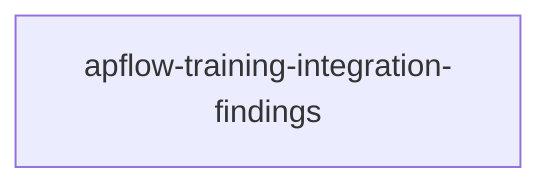

# Implementation Overview

## Overall Progress
[##########] 7/7 tasks; modules: 1 completed, 0 in progress, 0 pending.

## Module Overview
| # | Module | Description | Status | Progress |
|---|---|---|---|---|
| 1 | [Training integration](./apflow-training-integration-findings/overview.md) | All fourteen APF findings | completed | 7/7 |

## Module Dependencies

## Recommended Implementation Order
First restore core invariants, bootstrap/identity and outbound/readiness in parallel because they have independent owners. Next add atomic submissions and classified retries. Then integrate persistent dispatch and shared budgets against those stable boundaries.
